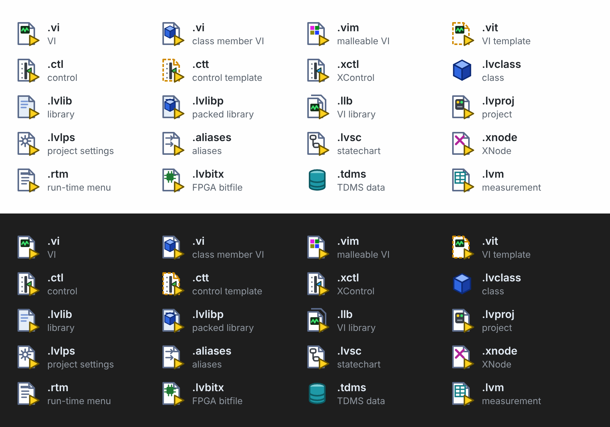

# File Icons for LabVIEW

File icons for LabVIEW files in the VS Code explorer, tabs and breadcrumbs.

## Features

- Icons for LabVIEW file types. The icons keep the LabVIEW cues: folded page, yellow connector triangle and the native glyph colours.
- A class-member VI icon for VIs owned by a `.lvclass`.
- XML highlighting for XML-based LabVIEW files. INI highlighting for `.aliases` and `.lvlps`.



## Requirements

- An icon theme that shows language icons. Seti, the default theme, does. If your icon theme has its own icon for a file extension, that icon wins.

## Class-member VIs

The extension reads every `.lvclass` file in the workspace and finds the member VIs. It writes these VIs to `files.associations` in the workspace settings (`.vscode/settings.json`, or the `.code-workspace` file for multi-root) with the value `labview-vi-class`.

- When all VIs below a class folder are class members, the extension writes one glob for that folder. Otherwise it writes one entry for each VI.
- Entries with other values are not changed.
- The entries refresh when `.lvclass` or `.vi` files change.
- This feature needs a trusted workspace. File icons also work in Restricted Mode.

## Extension Settings

- `labviewIcons.classMemberIcons` (default `true`): show the class-member icon. Set `false` to remove the managed entries.

## Commands

- `LabVIEW Icons: Refresh Class Member Icons`
- `LabVIEW Icons: Remove Class Member Associations`

## Development

```sh
npm ci
npm run lint
npm test
npm run package   # writes output/labview-file-icons-<version>.vsix
```

Press F5 to start an Extension Development Host.

To change an icon, edit `tools/build_icons.py` and run `npm run icons`. This also rebuilds `images/icons-preview.svg`. Render it to `images/icons-preview.png` for the README (the Marketplace does not accept SVG images). `images/icon.png` is rendered from `images/icon.svg`.

Install locally with:
```
code --install-extension labview-file-icons-x.x.x.vsix
```

## Release

1. Update `version` in `package.json` and `CHANGELOG.md`.
2. Commit, then tag `v<version>` and push the tag.
3. CI checks that the tag matches the version, builds the `.vsix` and attaches it to a GitHub Release.
4. Download the `.vsix` from the GitHub Release.
5. Open the [Marketplace publisher page](https://marketplace.visualstudio.com/manage) and upload the `.vsix`:
   - First release: **New extension → Visual Studio Code**.
   - Later releases: the extension's **⋯** menu → **Update**.

## Trademarks

LabVIEW is a trademark of NI (Emerson). This extension is not affiliated with or endorsed by NI.
